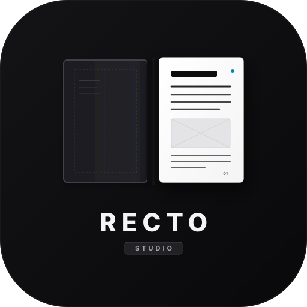

<p align="center">
  
</p>

<h1 align="center">Recto Studio</h1>

<p align="center">
  Open-source desktop publishing for books, magazines, zines, and print.
</p>

<p align="center">
  <a href="https://artificia1.github.io/recto-studio/"><strong>Open Studio</strong></a> ·
  <a href="https://github.com/artificia1/recto-studio/releases/latest"><strong>Download desktop builds</strong></a> ·
  <a href="PUBLISHING.md">Publishing guide</a> ·
  <a href="PUBLISHING_AUTOMATION.md"><strong>MCP setup</strong></a>
</p>

[](https://github.com/artificia1/recto-studio/actions/workflows/deploy.yml)
[](LICENSE)

Recto Studio is a local-first page layout editor. Set a manuscript in linked
frames, build a visual system with parent pages and styles, then prepare the
same publication for print, EPUB, or review. Recto is designed for independent
publishers and editorial designers, with the same canvas available for covers,
brochures, catalogs, and other short-form work.

## New · Local publishing through MCP

**Design once in Recto. Automate the next edition.** Connect a local Model
Context Protocol (MCP) client to a saved publication and use Recto’s layout
and export engines to prepare proofs, translations, and personalized runs.

| Try this | What Recto gives you |
| --- | --- |
| **Fix a crowded magazine page.** Check page 4 for overset and preview a small tracking adjustment. | Before-and-after layout and preflight findings. Save the approved edit as a separate editable draft. |
| **Review a translated catalog.** Bring in reviewed XLIFF translations and check reflow. | A new language edition with reported font and layout risks, while the source edition stays intact. |
| **Make 50 personalized event programs.** Merge a CSV and local speaker photos into one design. | An individual PDF per record and a manifest for the batch. |
| **Deliver a book interior.** Inspect chapter start pages and blanks, then compile a portable book archive. | A single interior PDF assembled from the saved chapter snapshots. |

The server is an opt-in CLI command with read-only access by default. It opens
the workspace folder you choose. The desktop and web editors launch as usual.

[**Set up Recto MCP and try the example prompts →**](PUBLISHING_AUTOMATION.md)

## Start a publication

1. **Choose the format.** Start from a blank document or a layout starter.
   Set trim, margins, bleed, guides, and facing pages.
2. **Place copy and artwork.** Import a Word, Markdown, or plain-text manuscript.
   Use linked text frames, parent pages, reusable artwork, and document fonts.
3. **Review and deliver.** Check overset and preflight issues, compare PDF
   proofs, and export a print PDF, EPUB, HTML flipbook, or publication package.

Keep a `.recto` project as your editable source. Use **Export → Save Editable
Project Archive** to back up all editions, including nonprinting material,
in one file. [Project archive and print package guide](PUBLISHING.md#project-archives-and-print-packages)

The browser editor opens without an account. Choose **File → Install or use
offline** for app installation and offline setup. On macOS Sonoma 14 or later,
open Recto in Safari and choose **File → Add to Dock**. The [desktop guide](DESKTOP.md)
covers Windows, Linux, and the downloadable macOS preview.

Use `V` for Selection, `T` for Type, `P` for Pen, and `W` for Preview.

Use the toolbar’s **Appearance** button to open the workspace popup. Choose
Dark, Light, Midnight, OLED, or System, set a preset or custom accent color, and
pick Classic, Minimal, or Glass controls. Recto saves these preferences on this
device. Quick Apply (`Ctrl+/`) can switch themes from the keyboard.

The hosted editor supports optional aggregate visit and unique-browser counts.
See the [visit counter setup](visit-counter/README.md) for the data and deployment details.

Use **Links → Bulk relink images** to match replacement files by filename and
review them before applying. Use **Templates → Saved layouts** to reuse
standalone artwork and text from a spread. Export a `.rectolayout` file to move
the layout to another device.

## What's in the editor

| Workflow | Shipped tools |
| --- | --- |
| **Long documents** | Book assembly with chapter refresh and cross-chapter references, automatic story pagination, section labels, tables of contents, multi-level indexes, footnotes and endnotes, and numbered figures and tables |
| **Typography** | Paragraph and character styles, baseline grids, column balancing, optical margins, copyfit, supported CJK composition, editable LaTeX equations, and variable-font controls |
| **Font files** | TTF, OTF, WOFF and WOFF2 import, face selection from TTC and OTC collections, document-wide font replacement, and searchable PDF embedding for supported static and variable fonts |
| **Artwork** | Bézier and freehand tools, editable linear and radial gradients, shape-to-path conversion, text wrap, reusable artwork, and alignment and distribution |
| **Tables and catalogs** | Linked table continuations, repeating headers and footers, row splitting and vertical merges, data merge, and conditional editions |
| **Press and review** | ICC conversion, separations and ink-coverage previews, printer profiles, spot inks, PDF/X candidates, proof comparison and PDF comment import, cover spines, and booklet imposition |
| **File handoff** | Editable Scribus 1.6 import, IDML import and export for supported features, and an InDesign round-trip check script |
| **Translation** | XLIFF handoff, bilingual review, reusable translation memory, and editable language editions with layout and font checks |
| **Delivery** | Print and tagged PDFs, PDF/UA-1 export, EPUB 3, HTML flipbooks, publication packages, and headless batch publishing |

Some workflows have format-specific limits. The guides explain what carries
over, which checks run automatically, and what needs review before production.

## Pick a guide

- [Manuscripts and stories](MANUSCRIPTS.md)
- [Fonts, variable axes, and PDF embedding](FONTS.md)
- [Publishing, proof review, and prepress](PUBLISHING.md)
- [InDesign and IDML handoff](INDESIGN_IMPORT.md)
- [Collaboration](COLLABORATION.md) · [Scripting](SCRIPTING.md)
- [Desktop installation](DESKTOP.md) · [Performance](PERFORMANCE.md)
- [Local publishing automation](PUBLISHING_AUTOMATION.md)

## Upcoming work

- **Editorial interchange.** Expand IDML and Scribus coverage for compound
  paths, complex groups, linked images, and advanced typography. Run a broader
  handoff corpus through licensed InDesign installations.
- **Print verification.** Exercise real press and RIP workflows with the Ghent
  Output Suite, add checks against printer-supplied preflight profiles, and
  extend coverage of trapping and colour effects.
- **Artwork and typography.** Add linked symbols, editable patterns and mesh
  fills, non-destructive image adjustments, and broader font and script coverage.
- **Production automation.** Expand MCP coverage for styles and artwork, add
  more data-source adapters, and extend repeatable book and batch delivery.

## Develop

CI uses Node.js 24. The web editor uses TypeScript, Preact, and Vite. The desktop
shell uses Tauri.

```sh
npm ci
npm run dev
```

```sh
npm test
npm run build
npm run analyze:bundle
npm exec -- vite optimize --force
npx playwright install chromium
npm run test:e2e
```

The [deployment workflow](.github/workflows/deploy.yml) runs regression and
browser tests plus independent checks on generated publication files.

## Project and support

Created by **Abhinav Sidhu**. Recto Studio is released under the [MIT License](LICENSE).

Thanks to [shega2901](https://github.com/shega2901) for testing real InDesign
exports and reporting IDML import and development startup bugs.

- **UPI** · `artificiaisme@okhdfcbank` · [Payment QR](public/upi-qr.png)
- **Solana (SOL or USDC)** · `26Z52ETXSHwQWLZX6BdgVFyDaTPSeKMbxJeY9S7SVmE6` · [Address on Solscan](https://solscan.io/account/26Z52ETXSHwQWLZX6BdgVFyDaTPSeKMbxJeY9S7SVmE6)

<details>
<summary>Sponsorship tiers</summary>

| Monthly | Tier |
| --- | --- |
| $3 | Coffee |
| $10 | Indie Publisher, with a backer badge and documentation credit |
| $25 | Production Supporter, with priority bug triage |
| $100 | Studio or Agency, with a linked logo in the project documentation |

</details>

Recto Studio™ and the Recto logo are trademarks of Abhinav Sidhu.
